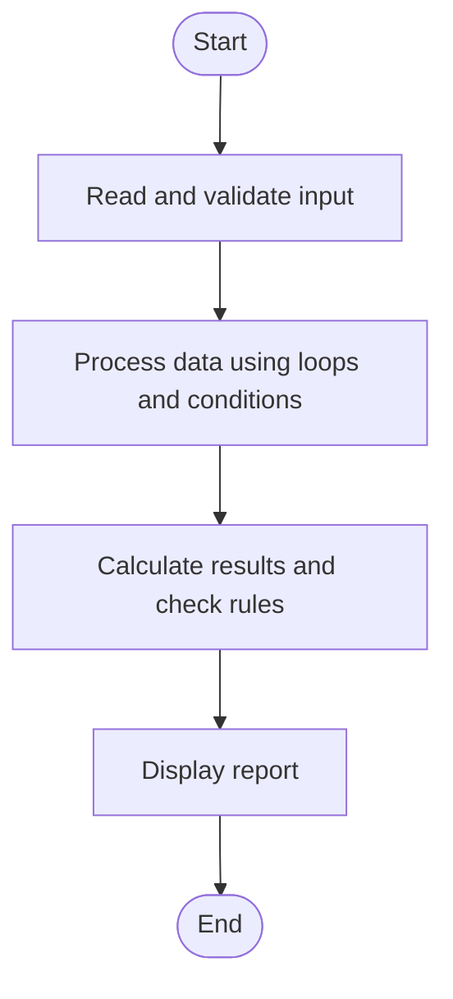

# Case Study 23: Student Timetable Conflict Detection

## 1. Problem Statement
Represent class schedules using tuples and detect overlapping time periods for the same day.

## 2. Objectives
- Store schedule records as tuples.
- Compare every pair of classes on the same day.
- Report clashes and confirm when the schedule is conflict-free.

## 3. Assumptions
- Times are entered as 24-hour HH:MM values.
- Each class has a start time earlier than its end time.
- Two periods overlap if start1 < end2 and start2 < end1.

## 4. Algorithm
1. Read the number of classes.
2. For each class, input subject, day, start, and end.
3. Convert times to minutes after midnight.
4. Compare each pair on the same day.
5. Print every overlap or a no-conflict message.

## 5. Flowchart


## 6. Pseudocode
```text
INPUT n
FOR each class: INPUT subject, day, start, end; convert times to minutes; store tuple
conflict = false
FOR i from 0 to n-1:
  FOR j from i+1 to n-1:
    IF same day AND start_i < end_j AND start_j < end_i: print clash; conflict = true
IF not conflict: PRINT no clashes
```

## 7. Python Source Code
See [`program.py`](program.py).

## 8. Test Cases
| Test input / condition | Expected result |
|---|---|
| Mon Math 09:00-10:00; Mon Physics 09:30-10:30 | One clash detected |
| Mon Math 09:00-10:00; Tue Physics 09:30-10:30 | No clash (different days) |
| Mon Math 09:00-10:00; Mon English 10:00-11:00 | No clash (touching endpoints) |

## 9. Sample Output
The `output_screenshot.png` file in this folder is a sample terminal-style output illustration. Run `program.py` with the test input to verify the actual output on your system.

## 10. Conclusion
Tuple records and nested loops are used to identify overlapping class periods on the same day.
