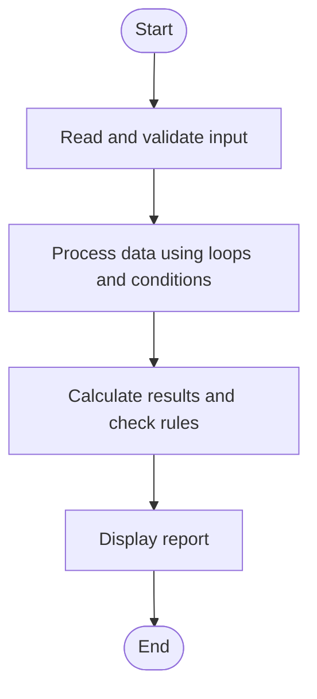

# Case Study 29: Password Policy Validation Engine

## 1. Problem Statement
Evaluate a sample password against length, uppercase, lowercase, digit, special-character, repeated-character, and prohibited-substring rules.

## 2. Objectives
- Check several password requirements.
- List each failed rule clearly.
- Avoid displaying or storing a real password in a production system.

## 3. Assumptions
- Minimum length is 8 characters.
- At least one uppercase letter, lowercase letter, digit, and non-alphanumeric character are required.
- Three identical consecutive characters are prohibited.
- The sample prohibited substring is 'password', case-insensitive.

## 4. Algorithm
1. Read a sample password for classroom testing.
2. Check each policy independently.
3. Collect failed rules in a list.
4. Print PASS if no rules fail; otherwise print each failure.

## 5. Flowchart


## 6. Pseudocode
```text
INPUT password
errors = empty list
IF length < 8: add length error
IF no uppercase: add uppercase error
IF no lowercase: add lowercase error
IF no digit: add digit error
IF no special character: add special error
IF 'password' in lowercase password: add prohibited-word error
IF any 3 consecutive characters are equal: add repetition error
PRINT result and errors
```

## 7. Python Source Code
See [`program.py`](program.py).

## 8. Test Cases
| Test input / condition | Expected result |
|---|---|
| Abcdef1! | Invalid: fewer than 8 characters |
| Study@2026 | Valid under sample policy |
| Password123! | Invalid: prohibited substring |
| AAAabc12! | Invalid: three identical consecutive characters |

## 9. Sample Output
The `output_screenshot.png` file in this folder is a sample terminal-style output illustration. Run `program.py` with the test input to verify the actual output on your system.

## 10. Conclusion
The validator demonstrates independent string checks and reports all failed policy conditions. The rules are educational examples, not a complete security standard.
