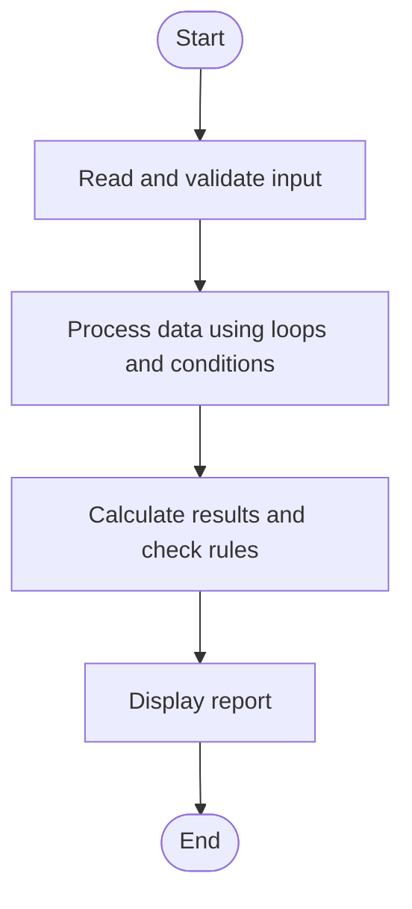

# Case Study 35: Text Compression Using Character Runs

## 1. Problem Statement
Encode consecutive repeated characters as a character followed by its run length and compare the encoded length with the original.

## 2. Objectives
- Identify consecutive runs of characters.
- Build a run-length encoded string.
- Determine whether encoding reduces the string length.

## 3. Assumptions
- The input may contain letters, digits, spaces, or punctuation.
- Each run is encoded as character followed by count, including count 1.
- This simple method is not intended for secure or general-purpose compression.

## 4. Algorithm
1. Read the input string.
2. If empty, report empty input.
3. Scan characters and count each consecutive run.
4. Append each character and its run count.
5. Compare original and encoded lengths.

## 5. Flowchart


## 6. Pseudocode
```text
INPUT text
IF text is empty: PRINT empty result
ELSE:
  current = first character; count = 1
  FOR each next character:
    IF same as current: count = count + 1
    ELSE: append current + count; set current to next; count = 1
  append final current + count
PRINT encoded string and both lengths
PRINT whether encoded is shorter
```

## 7. Python Source Code
See [`program.py`](program.py).

## 8. Test Cases
| Test input / condition | Expected result |
|---|---|
| aaabbc | a3b2c1; encoded length 6, same as original |
| aaaaabbbbb | a5b5; encoded length 4, shorter |
| abc | a1b1c1; longer than original |

## 9. Sample Output
The `output_screenshot.png` file in this folder is a sample terminal-style output illustration. Run `program.py` with the test input to verify the actual output on your system.

## 10. Conclusion
Run-length encoding groups repeated characters and demonstrates that a transformation does not always reduce data size.
