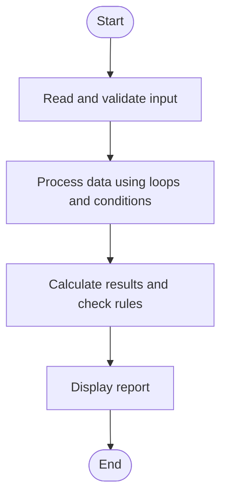

# Case Study 42: Student Marks Matrix Analysis

## 1. Problem Statement
Analyze a matrix of marks for multiple students and subjects, calculate student averages and subject averages, identify the top performer, and find subjects with low averages.

## 2. Objectives
- Store marks in a nested list.
- Compute row-wise and column-wise averages.
- Identify the top student and low-average subjects.

## 3. Assumptions
- Every mark is between 0 and 100.
- All students take the same subjects.
- A subject is flagged if its average is below 50.

## 4. Algorithm
1. Read student and subject names.
2. Input marks into a nested list.
3. Calculate each student's average.
4. Calculate each subject's average.
5. Find the top student and flag subjects averaging below 50.

## 5. Flowchart


## 6. Pseudocode
```text
INPUT student names and subject names
FOR each student: INPUT one mark per subject; store row
FOR each row: calculate average
FOR each column: calculate average
Find maximum student average
List subjects with average < 50
PRINT report
```

## 7. Python Source Code
See [`program.py`](program.py).

## 8. Test Cases
| Test input / condition | Expected result |
|---|---|
| 2 students, 2 subjects; A:[80,60], B:[40,40] | A avg 70; B avg 40; subject averages 60 and 50; A top |
| One student with 90, 90 | Student average 90; both subject averages 90 |
| Any mark -1 or 101 | Input rejected |

## 9. Sample Output
The `output_screenshot.png` file in this folder is a sample terminal-style output illustration. Run `program.py` with the test input to verify the actual output on your system.

## 10. Conclusion
The nested-list matrix supports both student-wise and subject-wise analysis with clear summary outputs.
