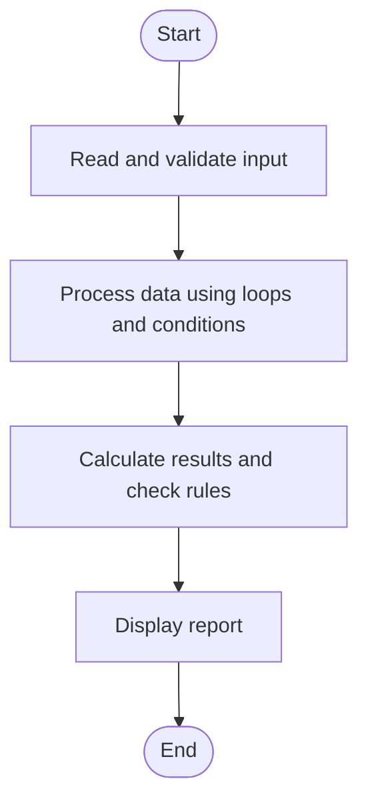

# Case Study 47: Sports Tournament Ranking System

## 1. Problem Statement
Store team match results, calculate points and goal difference, and rank teams with deterministic tie-breaking rules.

## 2. Objectives
- Calculate points from match scores.
- Compute goal difference.
- Rank teams by points, goal difference, then team name.

## 3. Assumptions
- A win earns 3 points, a draw 1 point, and a loss 0 points.
- Goal difference is goals for minus goals against.
- The final tie-break is team name in alphabetical order.

## 4. Algorithm
1. Read team names and initialize statistics.
2. For each match, read home and away goals.
3. Update goals for, goals against, and points.
4. Sort teams by points descending, goal difference descending, then name ascending.
5. Print the ranking table.

## 5. Flowchart


## 6. Pseudocode
```text
INPUT team names
Initialize points, goals_for, goals_against to 0
FOR each match: INPUT team A, team B, score A, score B
Update goals for/against
IF A wins: A points += 3; ELSE IF B wins: B points += 3; ELSE both += 1
Sort by (-points, -(goals_for-goals_against), name)
PRINT ranking
```

## 7. Python Source Code
See [`program.py`](program.py).

## 8. Test Cases
| Test input / condition | Expected result |
|---|---|
| A beats B 2-0; B draws C 1-1 | A 3 pts, B 1 pt, C 1 pt; B and C tie-break by goal difference then name |
| Two teams each win one by same margin | Points and GD tie; alphabetical name decides |
| Unknown team in a match | Match ignored with message |

## 9. Sample Output
The `output_screenshot.png` file in this folder is a sample terminal-style output illustration. Run `program.py` with the test input to verify the actual output on your system.

## 10. Conclusion
The program calculates tournament standings and applies explicit tie-breaking rules for reproducible rankings.
