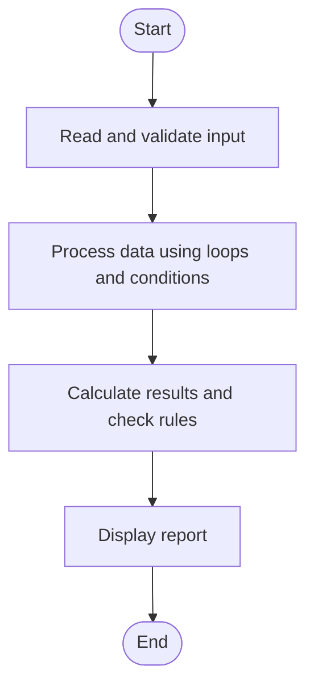

# Case Study 57: Smart Canteen Order and Stock Management

## 1. Problem Statement
Process customer orders, calculate bills, update inventory, reject unavailable quantities, and summarize sales and remaining stock.

## 2. Objectives
- Maintain stock quantities for menu items.
- Calculate order totals.
- Prevent stock from becoming negative and summarize daily sales.

## 3. Assumptions
- Menu prices and stock are supplied at startup.
- Each order line contains item name and quantity.
- No discount or tax is applied in this version.

## 4. Algorithm
1. Read menu items with price and stock.
2. Process each order line.
3. Validate item and quantity against available stock.
4. For valid orders, calculate line total, reduce stock, and add to sales.
5. Print total sales and remaining stock.

## 5. Flowchart


## 6. Pseudocode
```text
INPUT menu items, price, stock
sales = 0
FOR each order:
  INPUT item, quantity
  IF item unknown OR quantity <= 0 OR quantity > stock: reject
  ELSE: line_total = price * quantity; stock -= quantity; sales += line_total; print line total
PRINT sales and remaining stock
```

## 7. Python Source Code
See [`program.py`](program.py).

## 8. Test Cases
| Test input / condition | Expected result |
|---|---|
| Tea price 10 stock 5; order tea 2 | Accepted Rs.20; stock 3 |
| Sandwich stock 2; order 3 | Rejected; stock remains 2 |
| Unknown item | Rejected as not on menu |

## 9. Sample Output
The `output_screenshot.png` file in this folder is a sample terminal-style output illustration. Run `program.py` with the test input to verify the actual output on your system.

## 10. Conclusion
The canteen simulation links order processing to stock updates and maintains a correct sales total.
