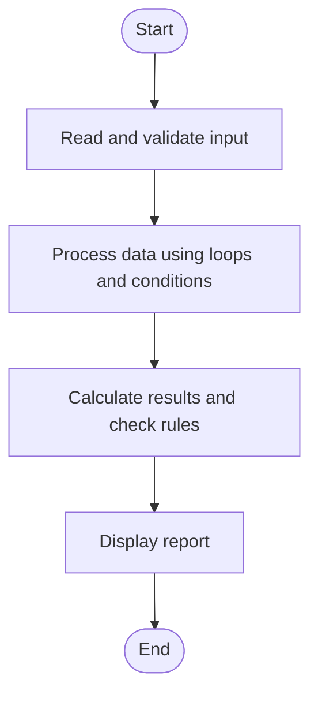

# Case Study 66: Student Academic Risk Classification

## 1. Problem Statement
Combine marks, attendance, and laboratory scores to classify students into risk categories and identify multiple risk factors.

## 2. Objectives
- Evaluate several academic indicators.
- Identify each student's risk factors.
- Summarize risk classifications.

## 3. Assumptions
- Marks and lab scores are percentages from 0 to 100.
- Attendance is a percentage from 0 to 100.
- Risk factors: marks below 50, attendance below 75, lab score below 50; 2 or more means High risk, 1 means Moderate, 0 means Low.

## 4. Algorithm
1. Read each student's marks, attendance, and lab score.
2. Validate all values.
3. Collect risk factors below their thresholds.
4. Classify by the number of risk factors.
5. Print student-level and overall counts.

## 5. Flowchart


## 6. Pseudocode
```text
FOR each student: INPUT name, marks, attendance, lab
Validate percentages
factors = []
IF marks < 50: add marks factor
IF attendance < 75: add attendance factor
IF lab < 50: add lab factor
IF number of factors >= 2: High
ELSE IF number = 1: Moderate
ELSE: Low
PRINT each student and counts by category
```

## 7. Python Source Code
See [`program.py`](program.py).

## 8. Test Cases
| Test input / condition | Expected result |
|---|---|
| marks 40, attendance 60, lab 45 | High risk; 3 factors |
| marks 80, attendance 70, lab 90 | Moderate risk; attendance factor |
| marks 80, attendance 90, lab 85 | Low risk; no factors |

## 9. Sample Output
The `output_screenshot.png` file in this folder is a sample terminal-style output illustration. Run `program.py` with the test input to verify the actual output on your system.

## 10. Conclusion
The system applies transparent threshold rules to classify hypothetical academic risk factors and summarize results.
