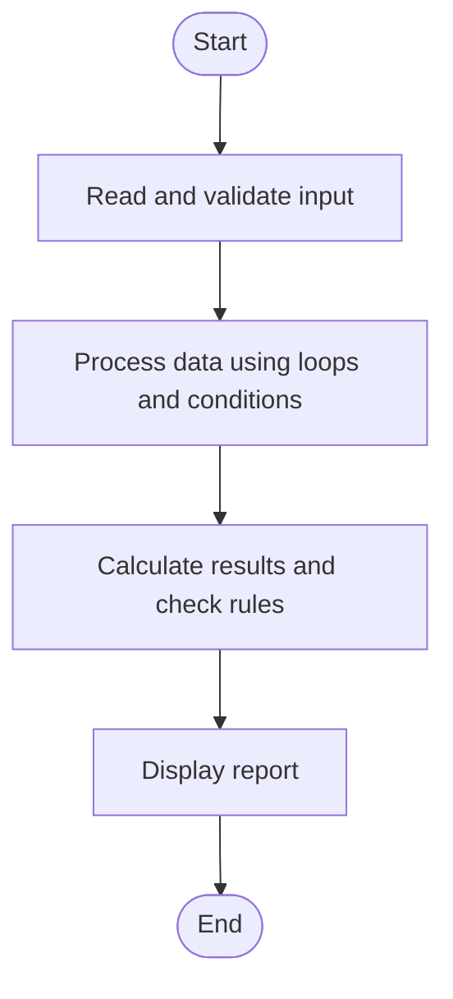

# Case Study 74: Campus Festival Registration and Financial Audit

## 1. Problem Statement
Reconcile participant registrations, fees, sponsorships, and expenses; detect duplicate registration identifiers and calculate the final financial balance.

## 2. Objectives
- Detect duplicate registration IDs.
- Calculate collected registration fees.
- Combine sponsorships and expenses to determine surplus or deficit.

## 3. Assumptions
- Each valid registration ID is counted once.
- Registration fee is fixed for all participants.
- Sponsorship and expense amounts must be non-negative.

## 4. Algorithm
1. Read registration fee and registration IDs.
2. Detect duplicates while counting unique registrations.
3. Read sponsorship and expense amounts.
4. Calculate total income and balance.
5. Print duplicate IDs and the financial audit.

## 5. Flowchart


## 6. Pseudocode
```text
INPUT fee, n
seen = empty list; duplicates = empty list
FOR each registration ID:
  IF ID in seen: add to duplicates
  ELSE: add to seen
INPUT sponsorship total and expense total
registration_income = length(seen) * fee
income = registration_income + sponsorship
balance = income - expenses
PRINT unique registrations, duplicates, income, expenses, balance
```

## 7. Python Source Code
See [`program.py`](program.py).

## 8. Test Cases
| Test input / condition | Expected result |
|---|---|
| Fee 100; IDs A1,A2,A1; sponsor 500; expenses 300 | 2 unique, duplicate A1; income 700; balance 400 |
| Fee 50; ID B1; no sponsor; expense 100 | Income 50; deficit 50 |
| Duplicate IDs repeated multiple times | Each duplicate ID listed once |

## 9. Sample Output
The `output_screenshot.png` file in this folder is a sample terminal-style output illustration. Run `program.py` with the test input to verify the actual output on your system.

## 10. Conclusion
The audit combines registration reconciliation and basic financial accounting, reporting duplicates and the final surplus or deficit.
